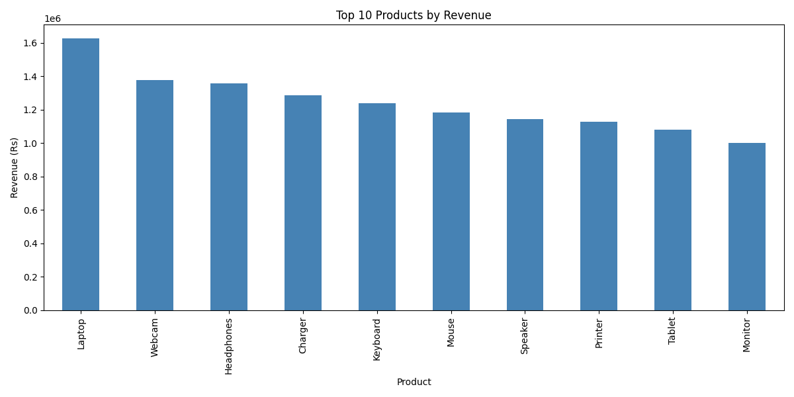
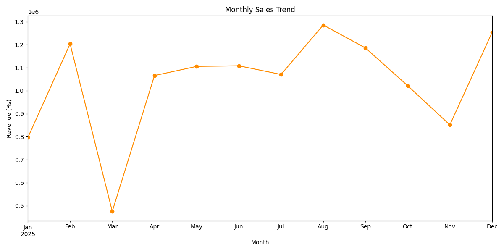
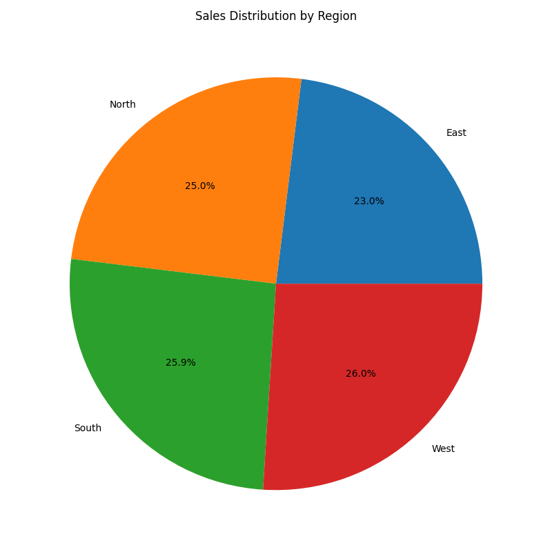
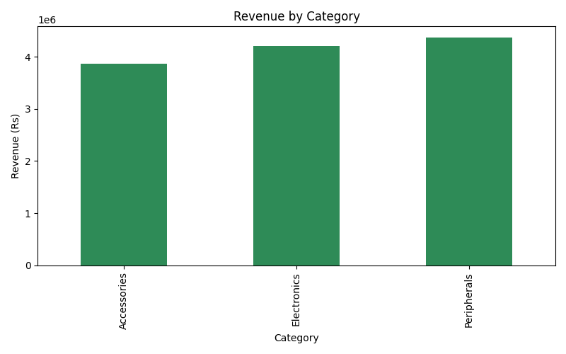

<div align="center">


</div>

<br/>

## ◈ Overview

This project is **Month 1 – Project 1** of the **CloudExify Data Science Summer Internship 2026**. It's an end-to-end exploratory data analysis (EDA) of a sales dataset — cleaning raw data, computing descriptive statistics, and visualizing revenue trends across products, categories, and regions using `pandas`, `NumPy`, and `matplotlib`.

---

## ◈ The Readout

```
  ▲  TOTAL REVENUE        Rs 12,423,188
  ▲  BEST MONTH            August, 2025
  ●  TOP PRODUCT           Laptop
  ▼  WEAKEST REGION        East
```

---

## ◈ At a Glance

|---|---|
|---|---|
| **Difficulty** | Beginner → Intermediate |
| **Language** | Python (Jupyter Notebook) |
| **Key Libraries** | pandas · NumPy · matplotlib |
| **Time Invested** | 9–11 hours |

---

## ◈ Repository Structure

```
cloudexify-ds-p1-MuhammadAhmadHamim/
├── charts/            filed exhibits — chart outputs
|   ├── category_comparison.png
|   ├── monthly_trend.png
|   ├── region_distribution.png
|   └── top_products.png
|   
├── sales_analysis.ipynb    line items — the full analysis, cell by cell
├── sample_data.csv         source ledger — raw sales records
├── sales_analysis_evaluation_report.pdf    closing statement — auto-generated summary
└── README.md
```

---

## ◈ The Process

Five passes over the data, each one narrowing from *what is this* to *what does it mean*.

**01 · Load & Inspect** — shape, dtypes, nulls, `df.describe()`. Nothing gets touched until it's understood.

**02 · Clean** — drop nulls, drop duplicates, cast `Date` to datetime. A dataset is only as trustworthy as its cleaning step.

**03 · Interrogate** — totals, mean, median, std dev, then grouped by product and region. This is where the real questions get asked.

```python
by_product = df.groupby('Product')['Amount'].sum().sort_values(ascending=False)
```

**04 · Visualize** — four views of the same story: top products (bar), revenue over time (line), regional split (pie), category comparison (grouped bar).

**05 · Report** — every stat above gets written to `report.txt` in plain language. A chart without a written takeaway is just decoration.

---

## ◈ Exhibits

<div align="center">

| Top Products | Monthly Trend |
|---|---|
|  |  |

| Region Distribution | Category Comparison |
|---|---|
|  |  |

</div>

---

## ◈ How to Run

```bash
# 1. Clone the repo
git clone https://github.com/MuhammadAhmadHamim/cloudexify-ds-p1-MuhammadAhmadHamim.git

# 2. Install dependencies
pip install jupyter pandas numpy matplotlib

# 3. Launch the notebook
jupyter notebook sales_analysis.ipynb
```

---

## ◈ Testing Checklist 

| Check | Status |
|---|:---:|
| CSV loaded, shape confirmed | ✅ |
| Missing values checked & handled | ✅ |
| Descriptive statistics generated | ✅ |
| Top 10 products — bar chart | ✅ |
| Monthly trend — line plot | ✅ |
| Regional split — pie chart | ✅ |
| Full summary report generated | ✅ |

---

<div align="center">

**CloudExify Summer Internship 2026** · Data Science Track · Month 1, Project 1


</div>